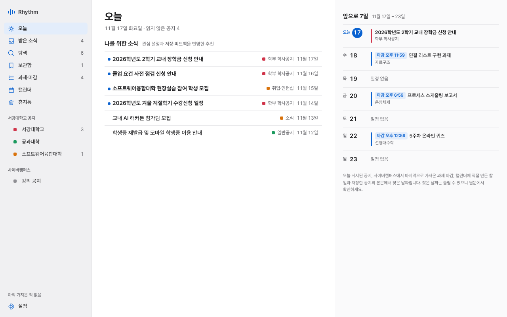
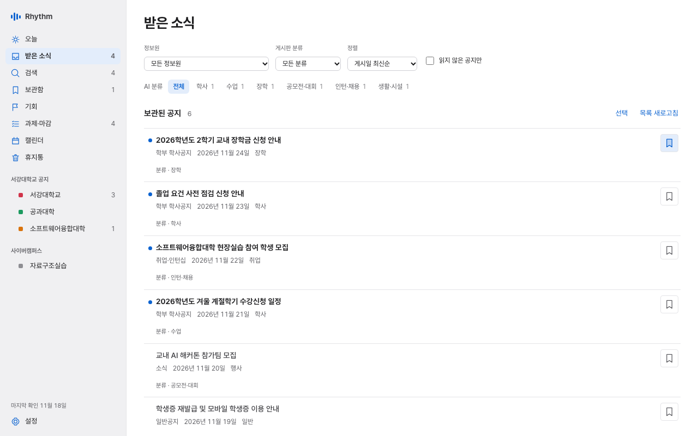
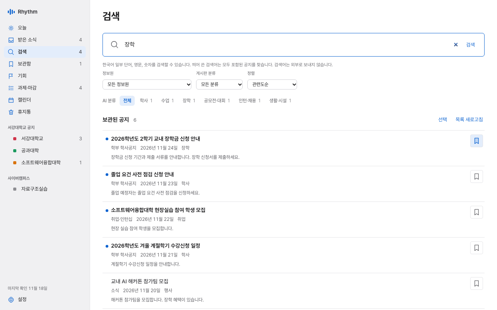
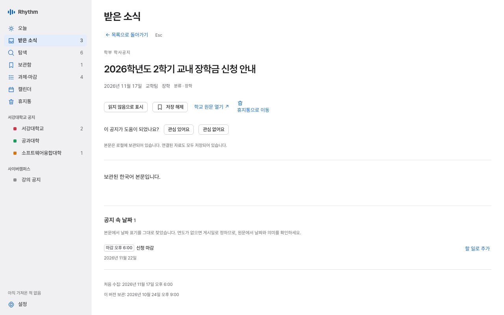
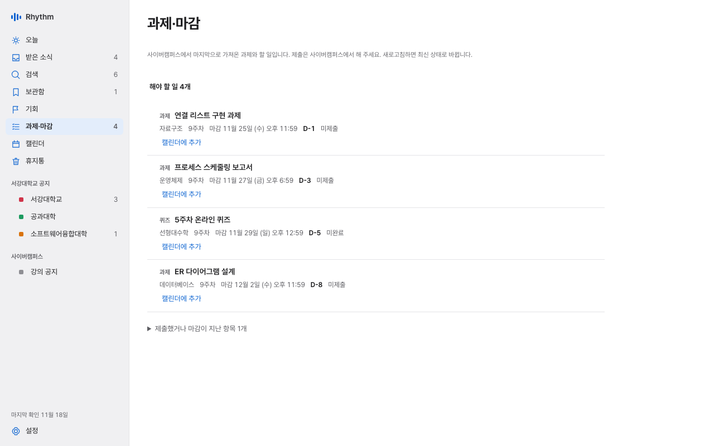

# Rhythm

**내 기기에 머무는, 나만의 하루를 위한 커맨드 센터.**

서강대학교 공지를 모아 보관하고, 공지 속 날짜를 캘린더로 정리하고, 나에게 중요한 소식부터 보여 주는 한국어 데스크톱 앱입니다. 계정이 없고, 개인 정보는 이 기기에만 둡니다.



| | |
| --- | --- |
|  |  |
|  |  |

## 기능

- 서강대학교 공개 게시판 공지를 받아 오프라인으로 읽고 검색
- 관심사에 맞춘 추천, 공모전·채용 같은 기회 모아 보기
- 사이버캠퍼스 과제·마감, 캘린더와 할 일, 열람실 빈 좌석 확인
- 필요한 기능만 **설정 → 확장 기능**에서 켜서 사용

## 설치

macOS(Apple Silicon)와 Windows 11 x64를 지원합니다. [Releases](https://github.com/Hiyabye/Rhythm/releases)에서 내려받으세요.

- **macOS:** `.dmg`를 열어 Rhythm을 응용 프로그램 폴더로 옮깁니다. Apple 공증을 받지 않아 처음 열 때 경고가 나오면, **시스템 설정 → 개인정보 보호 및 보안**에서 **그래도 열기**를 누릅니다.
- **Windows:** `_x64-setup.exe`를 실행합니다. 코드 서명이 없어 SmartScreen 경고가 나올 수 있습니다.

같은 이름의 `.sha256` 파일로 체크섬을 확인하고, 다르면 실행하지 마세요. Gatekeeper나 Windows 보안 기능은 끄지 마세요.

업데이트는 **설정 → 데이터 및 정보**에서 합니다.

## 개인정보

- 텔레메트리와 사용자 계정이 없습니다. 관심사, 저장·읽음 상태, 검색어, 할 일, 사이버캠퍼스 정보는 기기 밖으로 나가지 않습니다.
- 공지는 서버가 모아 서명한 공지 피드로 받고, 본문과 첨부 파일은 공지를 열 때 학교 사이트에서 받습니다.
- 백업 파일(`.rhythm-backup`)은 암호화되지 않으니 안전한 곳에 보관하세요.

## 소스에서 빌드

Node.js 22.12+, Rust 1.90+, [Tauri 사전 준비](https://v2.tauri.app/start/prerequisites/)가 필요합니다.

```sh
npm ci
npm run desktop          # 개발 모드
npm run desktop:build    # 릴리스 빌드
```

## 라이선스

[GPL-3.0-or-later](LICENSE). 서드파티 라이선스는 [assets/licenses/](assets/licenses/)에 있습니다. 학교 공지와 첨부 자료의 권리는 원저작자에게 있습니다.
