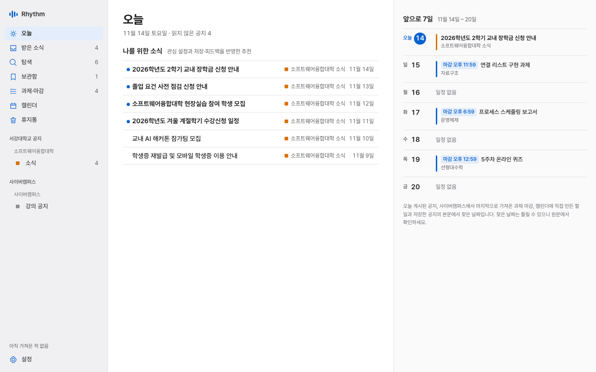
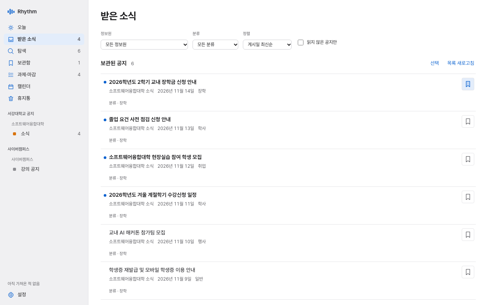
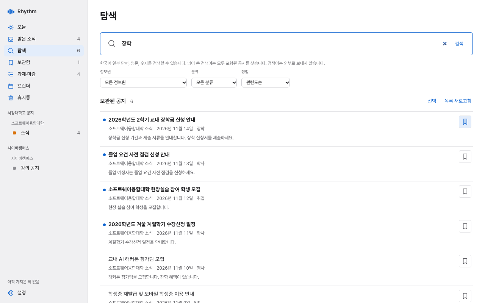
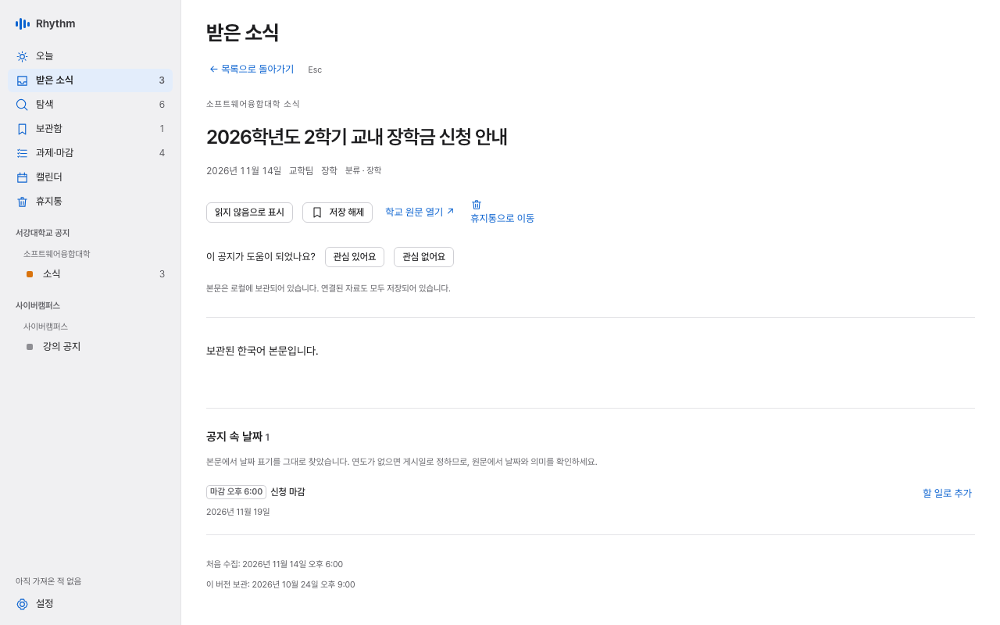
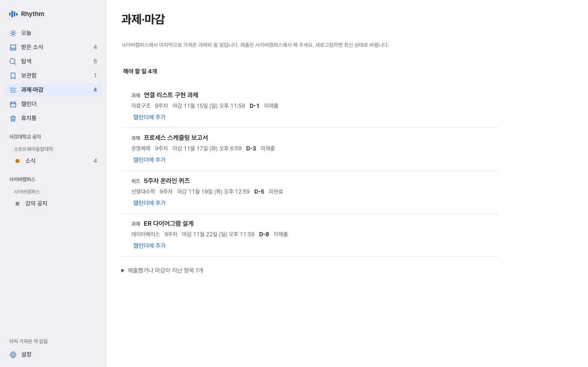
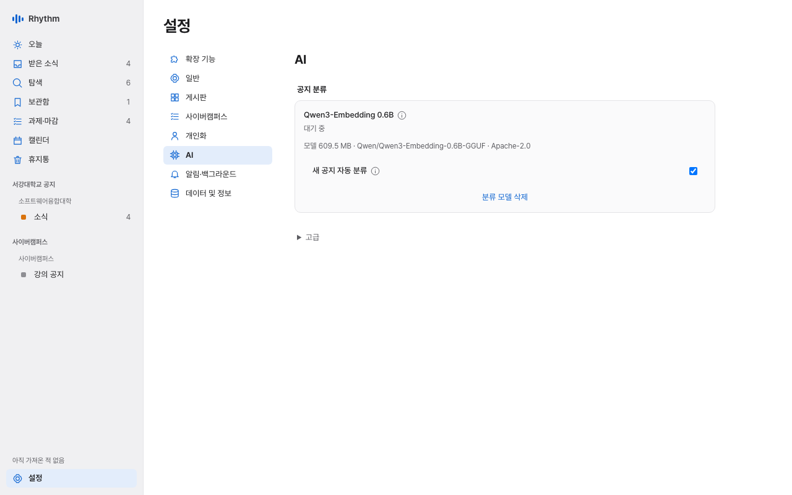

# Rhythm

**내 기기에 머무는, 나만의 하루를 위한 커맨드 센터.**

Rhythm은 학교 공지를 내 컴퓨터에 모아 보관하고, 공지 속 날짜를 캘린더로 정리하고, 나에게 중요한 소식부터 보여 주는 한국어 데스크톱 앱입니다. 계정이나 클라우드 없이 동작하며, 한 번 보관한 공지는 인터넷 없이도 읽고 검색할 수 있습니다. 공지 분류용 AI 모델도 이 기기에서만 실행합니다.



| | |
| --- | --- |
|  |  |
|  |  |

화면 이미지는 합성 데이터로 만든 예시입니다.

현재 버전: **1.10.1**

## 기능

- 필요한 기능만 켜서 쓰는 **확장 기능** 구조. 처음에는 **오늘**과 **설정**만 있고, 서강대학교 공지(받은 소식), 사이버캠퍼스(과제·마감), 탐색, 보관함, 나를 위한 소식, 앞으로 7일, 캘린더, 열람실, AI 분류, 알림·백그라운드를 **설정 → 확장 기능**에서 켜면 해당 화면과 설정이 나타납니다. 꺼도 보관한 자료와 설정은 지워지지 않습니다.
- 서강대학교 공개 게시판 34곳 구독. **새로고침** 한 번으로 새 소식과 변경을 확인하고, 아직 받지 않은 이전 공지를 이어서 가져옵니다.
- 오프라인 읽기, 제목·본문 한국어 검색(분류 모델을 설치하면 뜻이 비슷한 공지도 찾음), 읽음·저장 상태, 본문 이미지와 첨부 파일의 로컬 저장.
- 작은 로컬 임베딩 모델로 공지 분류, 비슷한 공지 찾기, 뜻으로 찾는 검색.
- 관심 분야, 공지별 피드백, 제어 가능한 학습을 바탕으로 한 설명 가능한 추천. AI 모델 없이도 동작합니다.
- 선택 사항: 사이버캠퍼스(eClass) 강의 공지·과제·퀴즈 마감, 메뉴 막대(Windows는 알림 영역) 상주, 로그인 시 자동 시작, 예약 동기화, 운영체제 알림.
- **캘린더**: 과제 마감과 저장한 공지에 적힌 날짜를 달력으로 보고, 날짜·시간·메모가 있는 할 일을 직접 만듭니다. **모든 공지의 마감 표시**를 켜면 저장하지 않은 공지의 마감도 함께 나타납니다. 날짜는 공지 본문의 표기를 그대로 찾은 것이라 틀릴 수 있으니 원문에서 확인하세요. 공지 속 날짜나 사이버캠퍼스 마감을 **할 일로 추가**하면 제목과 날짜가 채워진 입력 창이 열리고, 확인하고 저장해야 할 일이 됩니다. 공지에서 만든 할 일은 **원문**으로 그 공지를 다시 열 수 있습니다. 끝내지 않은 할 일은 앞으로 7일에도 나타납니다. 할 일은 이 기기에만 저장되고 알림은 보내지 않습니다.
- **열람실**: 선택한 여러 열람실의 빈 좌석 수와 확인된 좌석 번호를 직접 조회하거나, 앱 실행 중 자동 확인을 켤 수 있습니다. 방별 선호 좌석 저장·번호 검색·좌석 배치도를 제공하며, 원하는 조건을 만족할 때 운영체제 알림을 받도록 설정할 수 있습니다. 미니 창과 기존 메뉴 막대·알림 영역의 요약으로 같은 현황을 볼 수 있습니다.
- `.rhythm-backup` 단일 파일 백업과 복원.

## 지원 범위

- **플랫폼:** macOS Apple Silicon(arm64)과 Windows 11 x64. macOS는 27.2에서, Windows는 PC 한 대에서 시험했습니다([Windows 검증 기록](docs/WINDOWS_VALIDATION.md)). Linux, Intel Mac, ARM Windows는 지원하지 않습니다.
- **서명:** macOS 앱은 Ad-hoc 서명이며 **Apple Developer ID 서명과 공증이 없습니다.** Windows 설치 파일은 **코드 서명이 없습니다.** 처음 열 때 보안 경고가 나타나며, 아래 설치 안내를 따르세요.
- **정보원:** 서강대학교 학사공지, 소프트웨어융합대학, 공과대학, 전자공학과, 시스템반도체공학과, 반도체공학과, 기계공학과, 벨라르미노 학사 게시판과 사이버캠퍼스 강의 공지(로그인 필요).

측정값과 시험 범위(AI 분류 정확도, 지원 GPU, 최소 macOS 버전, 알림·예약 동기화 동작)는 [AI 평가](docs/AI_EVALUATION.md), [로드맵의 검증 현황](docs/ROADMAP.md#verification-status), [아키텍처](docs/ARCHITECTURE.md), [Windows 빌드 안내](docs/WINDOWS.md)에 있습니다.

## 설치

### macOS

1. 공식 저장소 [github.com/Hiyabye/Rhythm](https://github.com/Hiyabye/Rhythm)의 **Releases**에서 `Rhythm_1.10.1_aarch64.dmg`와 `Rhythm_1.10.1_aarch64.dmg.sha256`을 내려받습니다. 다른 곳에서 받은 파일은 사용하지 마세요.
2. 터미널에서 체크섬을 확인합니다. 두 값이 정확히 같아야 하며, 다르면 파일을 열지 말고 삭제하세요.

   ```sh
   cd ~/Downloads
   shasum -a 256 Rhythm_1.10.1_aarch64.dmg
   cat Rhythm_1.10.1_aarch64.dmg.sha256
   ```

3. DMG를 열고 **Rhythm**을 **응용 프로그램** 폴더로 끌어 놓습니다.
4. Rhythm을 엽니다.

Rhythm은 Apple 공증을 받지 않아 처음 열 때 macOS가 "확인되지 않은 개발자" 경고를 표시하고 실행을 막을 수 있습니다. 이는 현재 배포 방식의 의도된 한계이며, Apple이 이 앱을 검사했다는 뜻이 아닙니다. 공식 저장소에서 받았고 체크섬이 일치하며 실행하기로 결정했다면, Apple의 [앱별 허용 방법](https://support.apple.com/guide/mac-help/mh40616/mac)을 따릅니다.

1. Rhythm을 한 번 열어 경고가 나타나면 닫습니다.
2. **시스템 설정 → 개인정보 보호 및 보안**의 **보안** 항목에서 Rhythm에 대한 **그래도 열기**를 누르고 로그인 암호를 입력합니다. 이 버튼은 실행을 시도한 뒤 약 1시간 동안만 표시됩니다.

**Gatekeeper나 macOS 보안 기능을 전체적으로 끄지 마세요.** 경고를 우회한다며 인터넷에서 받은 터미널 명령을 실행하지 마세요.

### Windows

1. 공식 저장소의 Releases에서 `Rhythm_<버전>_x64-setup.exe`와 같은 이름의 `.sha256` 파일을 내려받습니다.
2. PowerShell에서 체크섬을 확인합니다. 두 값이 같아야 하며, 다르면 실행하지 말고 삭제하세요.

   ```powershell
   Get-FileHash .\Rhythm_<버전>_x64-setup.exe -Algorithm SHA256
   Get-Content .\Rhythm_<버전>_x64-setup.exe.sha256
   ```

3. 설치 파일을 현재 사용자 계정으로 실행합니다. 프로그램은 `%LOCALAPPDATA%\Programs\Rhythm`에 설치됩니다. WebView2 Runtime이 없으면 설치 중에 Microsoft에서 내려받으므로 인터넷 연결이 필요합니다.
4. 시작 메뉴에서 Rhythm을 엽니다.

설치 파일에 코드 서명이 없어 Windows SmartScreen이 경고를 표시할 수 있습니다. 공식 저장소에서 받았고 체크섬이 일치할 때만 실행 여부를 직접 판단하세요. Windows 보안 기능을 끄지 마세요.

AI 분류는 CPU와 NVIDIA GPU(Vulkan)를 지원하며 **설정 → AI → 고급 → AI 실행 장치**에서 자동·CPU·GPU를 고릅니다. Windows에서 분류 모델의 실행은 시험하지 않았습니다.

## 시작하기

처음 실행하면 **초기 설정**에서 사용할 기능을 고르고, 고른 기능의 설정(게시판, 사이버캠퍼스, 관심사, AI, 백그라운드 실행, 알림)만 차례로 안내합니다. 건너뛰어도 되며, **설정 → 일반 → 초기 설정**에서 다시 열 수 있습니다. 이전 버전에서 업데이트하면 쓰던 기능이 그대로 켜져 있으며, 새로 추가된 열람실은 직접 켜야 합니다. 직접 설정하려면 다음 순서를 따릅니다.

1. **설정 → 확장 기능**에서 **서강대학교 공지**와 쓰고 싶은 기능을 켭니다. 그다음 **설정 → 게시판**에서 구독할 게시판을 고릅니다. 구독만으로는 수집을 시작하지 않습니다.
2. **새로고침**을 누릅니다. 중단해도 다시 누르면 이어서 가져옵니다.
3. **받은 소식**에서 읽고, **탐색**에서 검색하고, 중요한 공지는 저장해 **보관함**에 모읍니다. 필요 없는 공지는 휴지통 버튼이나 **선택**으로 여러 개를 한 번에 **휴지통**에 옮깁니다. 휴지통의 공지는 직접 비우기 전까지 언제든 복원할 수 있고, 영구 삭제한 공지는 다시 가져오지 않습니다. **설정 → 데이터 및 정보 → 오래된 공지 정리**에서 기간(1·3·6개월, 1·2년)을 고르면 게시일이 그보다 오래된 공지를 휴지통으로 옮깁니다. 저장한 공지는 옮기지 않고, 기본값은 안 함입니다.
4. 선택 사항: **설정 → 개인화**에서 관심 분야를 추가하면 **오늘**의 추천에 반영됩니다.
5. 선택 사항: **설정 → AI**에서 분류 모델을 설치하면 공지를 주제별로 나누고 비슷한 공지를 보여 줍니다.

백그라운드 실행, 자동 동기화, 알림은 **알림·백그라운드** 확장 기능을 켠 뒤 **설정 → 알림·백그라운드**에서 켭니다. 모두 기본값이 꺼짐입니다. **Rhythm이 실행 중이고 컴퓨터가 깨어 있을 때만 동기화하고 알립니다.** macOS 알림 권한은 **권한 요청**을 직접 누를 때만 묻습니다.



### 사이버캠퍼스(선택)

**설정 → 확장 기능**에서 **사이버캠퍼스**를 켠 뒤 **설정 → 사이버캠퍼스**에 학번과 SAINT 비밀번호를 입력하면, 로그인을 확인한 뒤에만 저장합니다. 비밀번호는 운영체제 보안 저장소(macOS Keychain, Windows Credential Manager)에만 저장하며 데이터베이스, 백업, 진단에는 들어가지 않습니다. **강의 공지**를 구독하고 새로고침하면 이번 학기 수강 강좌의 공지·첨부 파일과 과제·퀴즈 마감을 가져옵니다.

- 읽기만 하며 제출이나 게시는 하지 않습니다. 다만 공지 본문을 처음 가져올 때 eClass에는 그 공지를 연 것으로 기록되고 조회수가 오를 수 있습니다.
- 첫 동기화는 강좌 수에 따라 몇 분 걸릴 수 있습니다. eClass가 비밀번호를 거부하면 계정이 잠기지 않도록 다시 저장할 때까지 자동으로 시도하지 않습니다.
- 조교로 참여하는 강좌와 지난 학기 강좌는 가져오지 않습니다.

### 열람실(선택)

**설정 → 확장 기능**에서 **열람실**을 켠 뒤 왼쪽의 **열람실** 화면에서 확인할 열람실을 하나 이상 골라 저장하고 **지금 확인**을 누릅니다. 조회할 여러 방과 화면에 표시할 방을 따로 고를 수 있습니다. 처음에는 로욜라 인벤툼 II 한 곳이 선택되어 있습니다. 확장 기능을 켜거나 화면·선택을 바꾸는 것만으로는 학교에 요청하지 않습니다.

빈 좌석 수, 확인된 번호와 학교 페이지의 기준 시각을 함께 표시합니다. 번호를 검증할 수 없으면 확인된 수만 표시합니다. 조회에 실패한 방의 이전 수와 번호는 지우고 원인을 표시하며, 다른 방의 이번 조회 성공 결과는 유지합니다. 실패를 0석으로 표시하지 않습니다.

방별 **선호 좌석 번호**를 쉼표나 공백으로 구분해 저장하면 확인된 빈 번호 중 해당 좌석을 ★로 강조합니다. 중복 번호와 정원 밖 번호는 저장하지 않습니다. 조회 대상에서 뺀 방의 선호 설정도 유지합니다. **빈 좌석 번호 검색**은 번호 하나와 정확히 일치하는 빈 좌석을 찾으며, 전체 빈 좌석 수와 검색 결과 개수를 따로 표시합니다. 저장·검색만으로 학교에 요청하지 않습니다. 표시할 방을 바꾸면 저장하지 않은 선호 번호와 검색을 초기화합니다. 오래된 조회의 강조는 이전 조회 기준이며, 번호를 확인하지 못한 경우 빈자리 여부를 추정하지 않습니다.

**좌석 배치도 열기**를 누르면 같은 응답에서 확인한 번호의 상대 위치를 봅니다. ○는 빈 좌석, ×는 사용 중, ★는 선호 설정이며 검색한 빈 좌석 번호에는 밑줄을 표시합니다. 50–200%로 확대·축소하고 배치도에 포커스를 둔 뒤 방향키나 스크롤로 이동할 수 있습니다. 원래 번호 목록도 유지합니다. 실제 좌석의 크기·형태나 벽·문을 그린 도면은 아니며, 위치를 확인하지 못해도 검증된 수와 번호는 그대로 표시합니다. 배치도 열기·확대·이동은 새로 조회하지 않고, 오래된 배치도는 이전 조회 기준임을 표시합니다.

**자동 확인 시작**을 누르면 바로 한 번 확인하고, 각 확인이 끝난 뒤 저장한 간격만큼 기다립니다. 기본 간격은 5분이며 2–60분으로 저장할 수 있습니다. 간격 저장만으로 조회하지 않고, 대기 중 간격을 바꿔도 현재 예약은 유지하며 다음 확인 완료 뒤 새 간격을 적용합니다. 직접 시작한 확인이 진행 중이면 그 작업부터 마칩니다. **자동 확인 일시정지**는 자동 확인을 멈추고, 직접 시작한 확인은 계속합니다.

자동 확인은 기본 꺼짐이며 앱 실행 중에만 동작합니다. 학교 서버가 접근을 거절하거나 요청을 제한하면(HTTP 401·403·429) 자동 확인을 중단합니다. 열람실 끄기, 백업·복원·업데이트 준비, 앱 종료 때도 중단되며 자동으로 다시 시작하지 않습니다.

**좌석 알림 조건**은 방마다 기본 꺼짐입니다. 빈 좌석 수가 정한 기준 이상이거나, 저장한 선호 좌석 중 빈자리가 있을 때 알리도록 조건을 저장합니다. **알림·백그라운드** 확장 기능의 전체 운영체제 알림과 OS 권한도 허용되어 있어야 하며, 권한 요청은 기존 알림 설정에서 직접 수행합니다. 수동·자동 조회의 최신 성공 결과로만 판단하고, 번호를 확인하지 못한 경우에는 빈 좌석 수 조건만 판단할 수 있습니다. 조건 저장 자체는 조회나 알림을 시작하지 않습니다.

조건을 처음 만족하면 한 번 알리고, 이후 성공한 조회에서 조건을 벗어났다가 다시 만족하면 다시 알립니다. 조회 실패로 반복 알리지 않습니다. 조용한 시간과 전체 알림의 10분당 최대 3회 제한을 공유하며, 제한으로 보내지 못한 경우 다음 최신 조회에서 다시 판단합니다. 전송 결과가 불확실하면 자동 재전송하지 않습니다. 알림 클릭은 해당 열람실을 열기만 하며 새로 조회하지 않고, 빈자리가 유지된다고 보장하지 않습니다.

**미니 창 열기**를 누르면 같은 조회 결과를 작은 창에서 볼 수 있습니다. 표시할 방을 바꾸면 기본 창에도 반영되며, **지금 확인**과 **확인 취소**는 같은 작업을 제어합니다. 창을 여닫거나 항상 위 표시를 바꾸는 것만으로는 새로 조회하지 않습니다. 미니 창을 닫아도 진행 중인 확인은 계속합니다. **항상 위에 표시**는 기본 꺼짐이고 창을 닫으면 초기화됩니다. 위치와 크기만 저장하며, 앱을 다시 실행할 때 미니 창을 자동으로 열지 않습니다.

기존 메뉴 막대 아이콘(Windows 알림 영역)이 있으면 **열람실 현황** 하위 메뉴와 툴팁에 선택한 방의 수·기준 시각·미조회·진행·실패·오래됨을 표시합니다. 기존 창 복원·종료·백그라운드 설정은 그대로 적용합니다.

조회 결과는 앱을 사용하는 동안만 유지합니다. 앱을 다시 열거나 열람실을 껐다 켜면 다시 확인해야 합니다. 선택한 방·표시할 방·자동 확인 간격·선호 좌석·알림 조건과 중복 방지 상태·미니 창 위치와 크기를 저장·백업합니다. 알림의 최소 전송 횟수 기록과 만료되는 클릭 정보도 이 기기에만 저장합니다. 자동 확인 켜짐·미니 창 열림·항상 위 상태와 좌석 수·조회한 번호·배치도 좌표·조회 이력은 저장하지 않으며, 재실행 자체는 조회나 알림을 시작하지 않습니다. 좌석 예약은 없습니다. 실서버·설치본 화면·실제 OS 알림·미니 창과 트레이의 검증 범위는 [검증 현황](docs/ROADMAP.md#verification-status)을 참고하세요.

## AI

모델 가중치는 앱에 포함되지 않습니다. **설정 → AI**에서 직접 설치를 누를 때만 내려받으며, 앱을 교체해도 다시 받을 필요가 없습니다. 분류 모델을 설치하면 새로 보관되는 공지와 아직 분류하지 않은 공지를 자동으로 분류하고, 비슷한 공지와 뜻으로 찾는 검색에도 씁니다. 모든 계산은 이 기기에서 하며 공지를 외부로 보내지 않습니다.

| 모델 | 용도 | 확인한 범위 | 라이선스 |
| --- | --- | --- | --- |
| Qwen3-Embedding 0.6B Q8_0 (0.64 GB) | 공지 분류·유사 검색 | Apple Silicon. Windows는 미검증 | Apache-2.0 |

파일은 고정된 리비전, 크기, SHA-256으로 검사합니다. 측정과 한계는 [AI 평가](docs/AI_EVALUATION.md)에 있습니다. 분류는 틀릴 수 있으며 추천 순위나 알림에는 쓰지 않습니다.

AI 요약, 이미지 인식, OpenAI 호환 원격 API는 더 이상 제공하지 않습니다. 업데이트하면 이전 요약 결과는 삭제되고, 저장해 둔 원격 API 키는 운영체제 보안 저장소에서 지웁니다. 이미 설치한 요약 모델은 **설정 → AI → 더 이상 제공하지 않는 모델**에서 직접 삭제할 수 있습니다. 원격 분류를 쓰고 있었다면 분류 모델을 설치해야 다시 분류합니다. 캘린더의 공지 날짜는 AI 없이 공지 본문에서 찾습니다.

## 게시판 수집의 한계

학교가 공개한 자료만 가져오며 로그인이나 접근 제한을 우회하지 않습니다.

- 사이트의 robots.txt가 금지한 자료(전자공학과·시스템반도체공학과 일부 이미지·썸네일·첨부 파일 등)와 HTTP 주소의 이미지, 외부 저장소의 첨부 파일은 받지 않고 "다운로드 미지원"으로 표시합니다. 기계공학과 첨부 파일은 원문 링크만 남깁니다. 본문은 항상 보관합니다.
- 공지에 넣은 이미지는 다른 공개 HTTPS 사이트에 있어도 받습니다(그 사이트의 robots.txt를 따릅니다).
- 지운 파일, 접근 제한 자료, 너무 큰 파일은 저장되지 않을 수 있고 각 자료의 상태가 표시됩니다. **자료 모두 내려받기**는 한 번에 최대 256 MB까지 받으며, 다시 누르면 이어서 받습니다.
- iframe만 있는 공지는 제목과 원문 참조만 보관합니다. 본문이 학교 PDF 뷰어뿐인 학부 학사공지는 PDF를 첨부 자료로 내려받고, PDF에서 추출한 텍스트를 본문으로 보여 줍니다. 표와 서식은 원본 PDF에서 확인하세요. 스캔 이미지로 된 PDF는 텍스트를 추출하지 못해 첨부 자료로만 보관합니다. 원문 형식을 읽지 못한 공지는 건너뛰고 게시판 상태(ⓘ)에 원문 링크와 함께 표시하며, 그곳에서 다시 시도할 수 있습니다.
- 벨라르미노 학사 일정 달력은 공지가 아니라 일정 항목이라 수집하지 않습니다.

## 백업과 복원

**설정 → 데이터 및 정보**에서 사용합니다.

- **백업:** 데이터베이스의 일관된 스냅샷과 내려받은 첨부 자료를 하나의 `.rhythm-backup` 파일로 저장합니다. AI 모델 가중치는 포함하지 않습니다.
- **⚠ 백업 파일은 암호화되지 않습니다.** 관심사, 피드백 같은 개인 정보와 (연결했다면) 사이버캠퍼스 강의 공지·과제 마감이 들어 있으니 안전한 위치에 보관하세요. 비밀번호와 API 키는 들어가지 않습니다.
- **복원:** 파일을 먼저 검사해 공지·자료 수와 버전을 보여 준 뒤, 확인 창에서 승인해야 진행합니다. 복원을 확정하면 Rhythm이 종료되며 **자동으로 다시 열리지 않습니다.** 직접 다시 열면 복원이 마무리되고 결과가 표시됩니다. 손상된 백업은 거부하며, 기존 데이터는 지우지 않고 앱 데이터 폴더에 복구용으로 보관합니다.
- Windows에서는 로컬 고정 NTFS 드라이브에 저장된 데이터만 복원할 수 있습니다.
- 복원한 목록의 AI 모델은 이 기기의 모델 파일이 크기와 SHA-256까지 일치할 때만 유지되고, 아니면 다시 설치하라고 안내합니다.

## 업데이트

**설정 → 데이터 및 정보**에서 **업데이트 확인**을 누르고 **다운로드 및 설치**, **설치 및 다시 시작** 순서로 진행합니다. Rhythm이 실행 중이면 하루에 한 번 자동으로도 확인해 알려 주며, 같은 화면에서 끌 수 있습니다. 내려받기와 설치는 직접 누를 때만 진행하고, 앱에 들어 있는 Rhythm 업데이트 키로 서명을 확인해 맞지 않으면 설치하지 않습니다. 이 서명은 파일이 Rhythm 릴리스에서 왔는지만 확인하며 Apple 공증이나 Windows 코드 서명을 대신하지 않습니다. 공지, 설정, AI 모델은 그대로 남습니다.

- macOS: 응용 프로그램 폴더 밖이나 디스크 이미지에서 실행 중이면 업데이트하지 않으니 먼저 Rhythm을 응용 프로그램 폴더로 옮기세요.
- 1.1.0 이하 버전과 직접 빌드한 앱은 앱 안 업데이트를 지원하지 않으므로, 새 버전을 위 설치 방법대로 한 번 직접 설치하세요. 먼저 Rhythm을 완전히 종료하고(⌘Q 또는 메뉴 막대의 종료, Windows는 트레이 메뉴) 필요하면 백업을 만드세요. 데이터는 앱과 별도로 보관되어 유지됩니다.

## 데이터와 개인정보

- **저장 위치:** macOS `~/Library/Application Support/io.github.hiyabye.rhythm/`, Windows `%LOCALAPPDATA%\io.github.hiyabye.rhythm\`. 클라우드 데이터베이스, 사용자 계정, 텔레메트리가 없습니다. 새 AI 모델을 받을 폴더는 **설정 → AI → 고급 → 모델 설치 폴더**에서 고를 수 있습니다.
- **네트워크:** 학교 공개 게시판 수집, 직접 켠 사이버캠퍼스 연결, 직접 요청하거나 자동 확인을 켠 열람실 좌석 확인, 요청한 모델 다운로드, 업데이트 확인에만 씁니다. 업데이트 확인 요청에는 개인 정보가 들어가지 않습니다. 프로필, 관심사, 피드백, 검색어는 외부로 보내지 않습니다.
- 운영체제 알림에는 정보원 이름과 공지 제목이 표시됩니다.
- 외부 링크와 **학교 원문 열기**는 직접 누를 때만 기본 브라우저에서 열립니다. 내려받은 첨부 파일은 보여 줄 뿐 자동으로 실행하지 않습니다.
- 앱을 지워도 데이터 폴더는 자동으로 삭제되지 않습니다. 완전히 지우려면 위 폴더를 직접 삭제하세요.

## 알려진 한계

- Windows의 실제 로그인 자동 시작, 절전 복귀, 알림 클릭과 다른 PC에서의 설치는 시험하지 않았습니다. 실제 학교 새 공지로 알림이 표시되는 장면과 실제 로그인 시 자동 시작도 시험하지 않았습니다.
- 모든 게시판의 공개된 이전 공지를 끝까지 가져오는 동작은 시험하지 않았으며, 오래된 공지의 수정 사항은 매번 전수 재검사하지 않습니다.
- AI 분류와 공지 속 날짜는 틀릴 수 있습니다. 합성 입력과 한 기기에서 시험한 결과이므로 정확도를 보장하지 않습니다.
- VoiceOver 음성 출력, 시스템 글자 크기, 대비 증가, 동작 줄이기는 충분히 시험하지 않았습니다.
- 사이버캠퍼스 연결은 한 계정의 이번 학기 강좌 5개로 시험했습니다. 다른 강좌 구성, 영어 화면, 학기 전환 시점은 시험하지 않았습니다.
- 열람실 좌석 조회는 학교 좌석 서버의 오래된 암호화 방식 때문에 운영체제의 TLS를 쓰며, 학교 인증서를 발급한 인증 기관 하나만 신뢰합니다. 학교가 인증 기관을 바꾸면 앱을 업데이트할 때까지 조회가 실패하고, 운영체제 TLS 정책에 따라 연결이 거부될 수도 있습니다.

## 소스에서 빌드

Node.js 22.12 이상, Rust 1.90 이상과 [Tauri 사전 준비](https://v2.tauri.app/start/prerequisites/)가 필요합니다. Windows는 [Windows 빌드 안내](docs/WINDOWS.md)를 따르세요.

```sh
npm ci
npm run desktop          # 개발 모드
npm run desktop:build    # 릴리스 빌드 (결과물: target/release/distribution/)
```

직접 빌드한 앱도 Ad-hoc 서명(macOS)이거나 서명이 없으며(Windows) 공증되지 않습니다. 개발 안내는 [AGENTS.md](AGENTS.md)에 있고, 설계와 검증 현황은 [로드맵](docs/ROADMAP.md)·[아키텍처](docs/ARCHITECTURE.md)·[디자인](docs/DESIGN.md)에 있습니다.

## 라이선스

Rhythm은 © Jihoon Lee와 기여자들의 저작물이며, [GNU General Public License 버전 3](LICENSE) 또는 (선택에 따라) 그 이후 버전(GPL-3.0-or-later)으로 배포합니다. Rhythm이나 수정본을 배포할 때는 같은 라이선스로 소스 코드를 함께 제공해야 합니다. 자체 제작한 Beat 로고도 같은 라이선스를 따릅니다. v1.7.1 이하 릴리스는 배포 당시의 MIT 라이선스를 그대로 따릅니다. [Pretendard](https://github.com/orioncactus/pretendard)는 SIL Open Font License 1.1이며 [라이선스 사본](assets/licenses/Pretendard-OFL.txt)을 저장소와 앱에 포함합니다. 앱에 포함된 [llama.cpp](https://github.com/ggml-org/llama.cpp)는 MIT 라이선스입니다. 사이버캠퍼스 연동은 [eclass-cli](https://github.com/rycont/eclass-cli)(MIT)를 바탕으로 했으며 [라이선스 고지](assets/licenses/eclass-cli-MIT.txt)를 저장소와 앱에 포함합니다. Qwen3.5와 Gemma 4 모델은 Apache-2.0이며 앱에 포함되지 않습니다(모델 출처: [unsloth](https://huggingface.co/unsloth), [Qwen](https://huggingface.co/Qwen)). 의존성은 각각의 라이선스를 따릅니다.

열람실 좌석 조회의 운영체제 TLS 연결에 쓰는 native-tls 0.2.18과 hyper-tls 0.6.0은 MIT/Apache-2.0 중 MIT를 선택하며, tokio-native-tls 0.3.1은 MIT입니다. 각 [native-tls](assets/licenses/native-tls-MIT.txt), [hyper-tls](assets/licenses/hyper-tls-MIT.txt), [tokio-native-tls](assets/licenses/tokio-native-tls-MIT.txt)의 원본 라이선스 고지를 저장소와 앱에 포함합니다. macOS 알림에 쓰는 mac-usernotifications 0.3.1(MIT 또는 Apache-2.0)은 알림 응답 정리 수정을 더한 사본을 저장소에 포함하며, [MIT](assets/licenses/mac-usernotifications-MIT.txt)와 [Apache-2.0](assets/licenses/mac-usernotifications-Apache-2.0.txt) 라이선스 사본을 저장소와 앱에 포함합니다.

학교 공지와 첨부 자료의 권리는 원저작자에게 있으며, Rhythm의 라이선스가 학교 자료의 재배포 권한을 부여하지는 않습니다.
